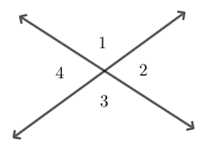
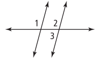
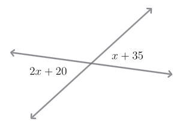

<!-- prettier-ignore -->
> Reminder: Full online book available through _ClassLink > Savvas EasyBridge_
{: .call-out}

- Use deductive reasoning to prove geometric theorems about lines and angles

## Assignment

- Four **vocabulary**{: .envision-vocab-purple} definitions
- **p56**{: .envision-hw-blue} 9–10, 14–18, 19–20\*, 21–22, 25 ([PDF link](./pdf/aga_gm_0107_pps.pdf){: target="\_blank"})

  \* _For 19–20, do not be discouraged if yours does not match the answer key._

## Additional Resources

- [Proofs involving angles](https://www.ixl.com/math/geometry/proofs-involving-angles){: target="\_blank"}
- [Find measures of complementary, supplementary, vertical, and adjacent angles](https://www.ixl.com/math/geometry/find-measures-of-complementary-supplementary-vertical-and-adjacent-angles){: target="\_blank"}

---

Now that we've looked at deductive reasoning, we're going to use that look at and construct **proofs**, which string together a series of deductions to get a conclusion. So, let's prove something new: the vertical angle theorem.

<!-- prettier-ignore -->
> ### Vertical Angles Theorem
>
> Vertical angles are congruent.
>
> > 
> >
> > **Figure 1.7.1** In the figure above, $\angle 1 \cong \angle 3$ and $\angle 2 \cong \angle 4$.
> {: .figure}
{: .definition}

It's one thing to say something, and quite another to prove it. Below is a **two-column proof** of the vertical angle theorem. Two-column proofs give a series of statements along with reasons why those statements can be made. By the end, those statements should lead to the conclusion that the theorem is true.

**Given**: $\angle 1$ and $\angle 3$ are vertical angles

**Prove**: $\angle 1 \cong \angle 3$

| Statements                                                                     | Reasons                             |
| ------------------------------------------------------------------------------ | ----------------------------------- |
| 1) $\angle 1$ and $\angle 3$ are vertical angles                               | 1) Given                            |
| 2) $m\angle 1 + m\angle 2 = 180^\circ$ and $m\angle 2 + m\angle 3 = 180^\circ$ | 2) Supplementary angles             |
| 3) $m\angle 1 + m\angle 2 = m\angle 2 + m\angle 3$                             | 3) Transitive property of equality  |
| 4) $m\angle 1 = m\angle 3$                                                     | 4) Subtraction property of equality |
| 5) $\angle 1 \cong \angle3$                                                    | 5) Definition of congruent angles   |

The aim of any proof is to have a self-contained set of steps that lead you from what's given to the conclusion. This means our given (or givens if multiple) is stated first.

After that, the chain of logic begins. The statements themselves might be enough for you, but the reasons are equally important. They refer to already proven facts you can reference if there is any doubt. Number 2 for instance, where $m\angle 1 + m\angle 2 = 180^\circ$, might be a leap of logic depending on the person. Since the reason is given, they can look up supplementary angles and see that the statement works.

## The Elephant in the Room

Proofs have a … reputation, and that comes from what doesn't show up in math classes often: justification. Instead of "do the steps" we've moved on to "justify the steps". This shift means we have open-ended problems with multiple correct answers. The Wikipedia page for the [Pythagorean theorem](https://en.wikipedia.org/wiki/Pythagorean_theorem){: target="\_blank"} lists _nine_ different proofs, one of which came from our 20th president, James A. Garfield.

Proofs and other open-ended problems represent the hardest problems you'll face in your life and career. The ones you can't solve just by looking up the solution. The ones where you'll have to justify your decision, either to your partner or boss.

So, to create a proof yourself—from scratch—it requires some planning. It can be difficult and you might not be able to do it on your own. Don't worry if that's the case. Get the help you need for whichever part of a proof is tripping you up.

And in case you are dreading the test on this, you won't be asked to write a full proof. Most of one will be given to you, and then you have to fill in the blanks from a short list of options.

## Theorem Bank

Constructing a proof requires you know a _lot_ of theorems. To help you out on the few proofs you have to create for homework, here is a list of proofs to help you out: [Properties Cheat Sheet](./pdf/properties-quick-reference.pdf){: target="\_blank"}. Along with that, the book introduces a few more.

<!-- prettier-ignore -->
> ### Congruent Supplements Theorem
>
> If two angles are supplementary to congruent angles, then the two angles are also congruent.
>
> **In symbols**: If $m\angle 1 + m\angle 2 = 180^\circ$, $m\angle 3 + m\angle 4 = 180^\circ$, and $\angle 2 \cong m\angle 4$, then $m\angle 1 \cong m\angle 3$.
{: .definition}

<!-- prettier-ignore -->
> ### Congruent Complements Theorem
>
> If two angles are complementary to congruent angles, then the two angles are also congruent.
>
> **In symbols**: If $m\angle 1 + m\angle 2 = 90^\circ$, $m\angle 3 + m\angle 4 = 90^\circ$, and $\angle 2 \cong m\angle 4$, then $m\angle 1 \cong m\angle 3$.
{: .definition}

<!-- prettier-ignore -->
> ### Linear Pairs Theorem
>
> The sum of the measures of a linear pair is $180^\circ$.
>
> **In symbols**: If $\angle 1$ and $\angle 2$ form a linear pair, then $m\angle 1 + m\angle 2 = 180^\circ$.
{: .definition}

## One More Proof

One more example proof.

<!-- prettier-ignore -->
> 
>
> **Figure 1.7.2** $m\angle 1 = m\angle 2$ and $m\angle 1 = 105^\circ$
{: .figure}

This time, we want to prove $m\angle 3 = 75^\circ$.

| Statements                                       | Reasons                              |
|--------------------------------------------------|--------------------------------------|
| 1) $m\angle 1 = m\angle 2$                       | 1) Given                             |
| 2) $m\angle 1 = 105^\circ$                       | 2) Given                             |
| 3) $m\angle 1 = m\angle 2$                       | 3) Transitive property of equality   |
| 4) $\angle 2$ and $\angle 3$ are a linear   pair | 4) Def. of a linear pair             |
| 5) $m\angle 2 + m\angle 3=180^\circ$             | 5) Linear pairs theorem              |
| 6) $105^\circ + m\angle 3=180^\circ$             | 6) Substitution property of equality |
| 7) $m\angle 3 = 75^\circ$                        | 7) Subtraction property of equality  |

## Applying Vertical Angles

The last bit in the section is using the vertical angle theorem. This is mostly algebra work since you need to set the expressions equal to each other and solve for $x$.

<!-- prettier-ignore -->
> ## Example: Applying Vertical Angles
>
> In the figure below, find the measure of the angles by determining the value of $x$.
>
> > 
> >
> > **Figure 1.7.3** Vertical angles of unknown measure.
> {: .figure}
{: .example}

**SOLUTION** Since we know vertical angles are congruent, we can set the two expressions equal to each other.

$$
\begin{align}
2x + 20 = x + 35
\end{align}
$$

Now that we have an equation, we can solve for the one variable.

$$
\begin{align}
2x + 20 &= x + 35 \\
 x + 20 &= 35 \\
      x &= 15
\end{align}
$$

And now that we know $x$, we can plug it back in to see that our vertical angles measure $50^\circ$.

$\blacksquare$
{: .qed}
