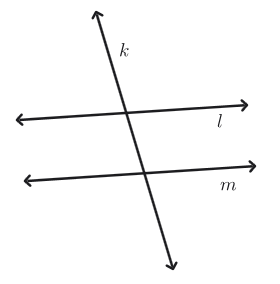
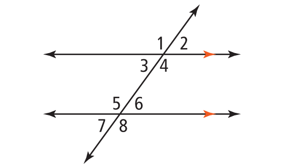

- Define parallel lines using the undefined terms point and line
- Prove theorems about lines and angles
- Use theorems to find the measures of angles formed by parallel lines and a transversal

## Assignment

- **p76**{: .envision-hw-blue} 12–13, 15–20, 23–28 (14 problems, [PDF link](./pdf/aga_gm_0201_pps.pdf){: target="\_blank"})

## Additional Resources

- [Transversals: name angle pairs](https://www.ixl.com/math/geometry/transversals-name-angle-pairs){: target="\_blank"}
- [Transversals of parallel lines: find angle measures](https://www.ixl.com/math/geometry/transversals-of-parallel-lines-find-angle-measures){: target="\_blank"}
- [Transversals of parallel lines: prove angle relationships](https://www.ixl.com/math/geometry/transversals-of-parallel-lines-prove-angle-relationships){: target="\_blank"}

---

What we're looking at for the next are parallel lines, or lines that don't intersect. In this section specifically, we'll look at parallel lines with a **transversal** cutting through them.

<!-- prettier-ignore -->
> 
>
> **Figure 2.1.1** Lines $l$ and $m$ are parallel, $l\parallel m$, and transversal $k$ intersects both of them.
{: .figure}

Another way to look at parallel line is that they have the same slope, or tilt. A line that is parallel to another is just a copy shifted.

<!-- prettier-ignore -->
> <video controls><source src="./img/2-1-parallel-animation.mp4"></video>
>
> **Figure 2.1.2** Parallel lines have the same slope.
{: .figure}

Since parallel lines are just shifted up or down, the angles formed by them and a transversal will be congruent. In the picture below angles that share the same position are congruent.

<!-- prettier-ignore -->
> {: width="250px"}
>
> **Figure 2.1.3** Corresponding angles formed by parallel lines and a transversal.
{: .figure}

That means ${\angle 1 \cong \angle 5}$, ${\angle 2 \cong \angle 6}$, ${\angle 3 \cong \angle 7}$, and ${\angle 4 \cong \angle 8}$. These are called **corresponding angles**.

<!-- prettier-ignore -->
> ### Corresponding Angles
>
> If a transversal intersects two parallel lines, then corresponding angles are congruent.
{: .definition}

In fact, because of linear pairs, you can derive each angle measure given just one.

<!-- prettier-ignore -->
> ### Example: Parallel Lines and Traversal Angles
>
> Using the figure above, if $m\angle 1= 120^\circ$, what are the remaining angle measures?
{: .example}

**SOLUTION** Just working around the top set of angles, $\angle 1$ and $\angle 2$ are a linear pair, making them supplementary. So, $m\angle 2 = 60^\circ$. $\angle 4$ matches up with $\angle 1$ as a vertical angle making that one also $120^\circ$. Similar reasoning will get you $\angle 3$ which is $60^\circ$.

Since the bottom set are corresponding angles, we can just match the angles to get the remaining ones. $\angle 1$ goes with $\angle 5$, $\angle 2$ with $\angle 6$, $\angle 3$ with $\angle 7$, and $\angle 4$ with $\angle 8$.

$\blacksquare$
{: .qed}

## Named Pairs

Once you have the above relationship down, the only thing you need to worry about are the names that are used for some of the pairs.