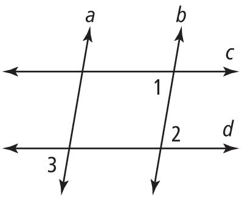
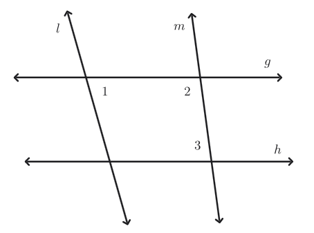

- Prove that two lines cut by a transversal are parallel using the converses of parallel line angle relationship theorems
- Use properties of parallel lines and transversals to solve real-world and mathematical problems
- Write and use flow proofs

## Assignment

- One **vocabulary**{: .envision-vocab-purple} definition
- Option 1: **p83**{: .envision-hw-blue} 10--15, 19, 20--24 (12 problems, [PDF link](./pdf/aga_gm_0202_pps.pdf){: target="\_blank"})
- Option 2: **IXL**{: .ixl} (SmartScore ≥70 on each)
  - [Transversals: prove lines are parallel](https://www.ixl.com/math/geometry/transversals-prove-lines-are-parallel){: target="\_blank"}

---

Last section, we looked at parallel lines cut by a transversal and found pairs of angles that would always be congruent or supplementary. It turns out that this works in reverse[^1]. If you have two lines that _may_ be parallel, then you can use those angle pairs to prove they are parallel.

<!-- prettier-ignore -->
> ## Example: Using Angles to Prove Lines Parallel
> 
> > {: width="200px"}
> >
> > **Figure 2.2.1** Four lines with questionable parallelism.
> {: .figure}
>
> In Figure 2.2.1 above, what do you need to know about $\angle 1$ and $\angle 2$ to prove $c \parallel d$?
>
> What about $\angle 2$ and $\angle 3$ for $a \parallel b$?
{: .example}

**SOLUTION** $\angle 1$ and $\angle 2$ are alternate interior angles around the transversal $b$. If they are congruent, then that would make line $c$ parallel to line $d$.

Similarly, $\angle 2$ and $\angle 3$ are alternate exterior angles around $d$. If they are congruent, then $a \parallel b$.

$\blacksquare$
{: .qed}

<!-- prettier-ignore -->
> ## Example: Finding Values for Parallel Lines
>
> > {: width="300px"}
> >
> > **Figure 2.2.2** Another four lines we want to be parallel.
> {: .figure}
>
> In Figure 2.2.2 above, let the following be true.
>
> - $m\angle 1 = 3x + 15$
> - $m\angle 2 = 5x$
> - $m\angle 3 = 2x + 40$
>
> Find the value for $x$ that makes $g \parallel h$.
{: .example}

**SOLUTION** Our lines in question have two transversals, but only $m$ has two angles we can use. $\angle 2$ and $\angle 3$ are same-side interior angles, so they must be supplementary for $g$ to be parallel to $h$.

$$
\begin{align}
180^\circ &= m\angle 2 + m\angle 3 \\[0.5em]
180 &= (5x) + (2x + 40) \\
180 &= 7x + 40 \\
140 &= 7x \\
 20 &= x
\end{align}
$$

$\blacksquare$
{: .qed}

[^1]: Unlike contrapositives, converses must be proven true since they are not automatically true. Example 2 gives us a proof for why alternate interior angles can prove lines are parallel.
