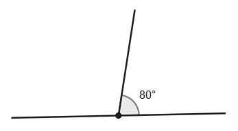
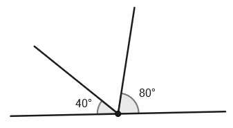
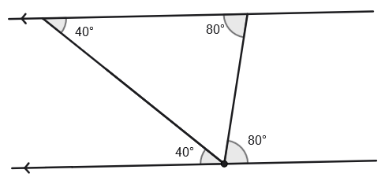
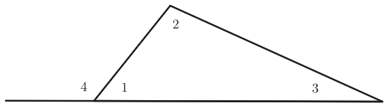

- Use lines constructed parallel to another line to solve problems and prove themselves
- Use the sum of the angle measures in a triangle to solve problems

## Assignment

- Option 1: **p90**{: .envision-hw-blue} 11--22, 24--25, 28--34 (21 problems, [PDF link](./pdf/aga_gm_0203_pps.pdf){: target="\_blank"})
- Option 2: **IXL**{: .ixl} (SmartScore ≥70 on each)
  - [Triangle Angle-Sum Theorem](https://www.ixl.com/math/geometry/triangle-angle-sum-theorem){: target="\_blank"}
  - [Exterior Angle Theorem](https://www.ixl.com/math/geometry/exterior-angle-theorem){: target="\_blank"}

---

## The Interior of a Triangle

A straight angle is an angle that measures $180^\circ$ and gets its name from it being just a straight line.

<!-- prettier-ignore -->
> {: width=\"\"}
>
> **Figure 2.3.1** A straight angle.
{: .figure}

If we take a straight angle and split it, we get supplementary angles. And if we know one of the angle measures, then we can find the other.

<!-- prettier-ignore -->
> {: width=""}
>
> **Figure 2.3.2** Supplementary angles with one measuring $80^\circ$. That would make the other one $100^\circ$.
{: .figure}

We can keep going. If we split it again so we have three angles, knowing two means we can find the third.

<!-- prettier-ignore -->
> {: width=""}
>
> **Figure 2.3.3** A straight angle split into three smaller angles. Since we know two measures, we can find the third which is $60^\circ$.
{: .figure}

And if we add a line parallel and extend the others, we get a triangle. Using what we know about alternate interior angles, we can match up the new angles.

<!-- prettier-ignore -->
> {: width=""}
>
> **Figure 2.3.4** A parallel line is added and with the alternate interior angles labeled.
{: .figure}

Since the straight angle was split into three, we know those three have to add up to $180^\circ$. And because of our parallel lines, our triangle shares the same angles. That means our triangle's angles have to also have to add up to $180^\circ$. And this fact hold true for all triangles.

<!-- prettier-ignore -->
> ### Triangle Angle-Sum Theorem
>
> The sum of angles of a triangle is equal $180^\circ$.
{: .definition}

## The Exterior of a Triangle

We can get a useful piece of information out of the whole $180^\circ$ property of triangles. Below is a triangle with one external angle labeled. These are made by extending one of the sides past a vertex.

<!-- prettier-ignore -->
> {: width=""}
>
> **Figure 2.3.5** A triangle with on external angle labeled.
{: .figure}

Two things to keep in mind for what's coming next:

1. The sum of the interior angles is $180^\circ$ and
2. linear pairs are supplementary and also add up to $180^\circ$.

Using that, we can write two equations.

$$\begin{align}
m\angle 1 + m\angle 2 + m\angle 3 &= 180^\circ \\
m\angle 1 + m\angle 4 &= 180^\circ
\end{align}$$

That must mean

$$\begin{align}
m\angle 2 + m\angle 3 = m\angle 4
\end{align}$$

This gives us our other theorem for this section.

<!-- prettier-ignore -->
> ### Triangle Exterior Angle Theorem
>
> The measure of a triangle's exterior angle equals the sum of the nonadjacent interior angles.
{: .definition}
