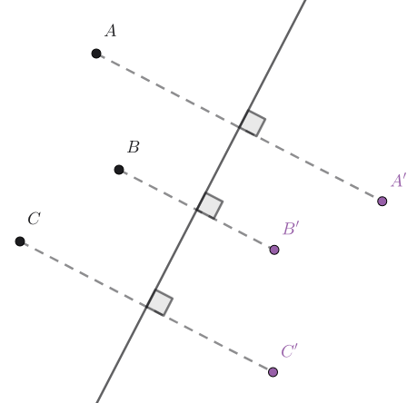
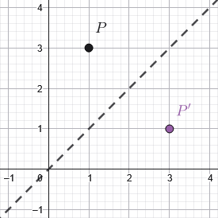

- Find a reflected image and write a rule for a reflection
- Define reflection as a transformation across a line of reflection with given properties and perform reflections on and off a coordinate grid

## Assignment

- One **vocabulary**{: .envision-vocab-purple} definition
- Option 1: **p111**{: .envision-hw-blue} 11--23, 26--35 (23 problems, [PDF link](./pdf/aga_gm_0301_pps.pdf){: target="\_blank"})
- Option 2: **IXL**{: .ixl} (SmartScore ≥70 on each)
    - [Reflections: graph the image](https://www.ixl.com/math/geometry/reflections-graph-the-image){: target="\_blank"}
    - [Reflections: find the coordinates](https://www.ixl.com/math/geometry/reflections-find-the-coordinates){: target="\_blank"}

---

## Rigid Motions

Reflections are the first of three of rigid motion we'll be looking at. A **rigid motion** is a movement (or transformation) that does not alter the lengths and angle measures of a figure. Along with reflections, the other two are translations and rotations.

## Reflecting a Point

> TIP: Most problems involve you reflecting a polygon, but it's usually useful to focus on point at a time. Once you have the first one figured out, the rest come easier.

Every reflection requires a **line of reflection**, which you can think of as mirror. If a point is 3 units away from the line of reflection, then it will appear 3 units away on the other side of the line.

Along with that, the line between a point and its reflection will always be perpendicular to the line of reflection.

<!-- prettier-ignore -->
> {: width="300"}
>
> **Figure 3.1.1** Three points reflected over a line.
{: .figure}

Those two properties make the line of reflection a **perpendicular bisector** between a point and its reflection.

## Determining the Reflected Point

Usually, drawing is your best bet. For now, we'll only worry about reflecting over horizontal and vertical lines. Mark your points on a graph paper, draw the line, and then use the grid to determine where the reflected point will end up. Remember that $y=c$ means a horizontal line and $x=c$ is a vertical line.

### Special Cases

There are three special lines of reflection that have simple rules, making them helpful if you remember them.

1. $y$-axis. Just a vertical line at $0$, so any point $(x,y)$ will reflect to $(-x,y)$.

2. $x$-axis. A horizontal line at $0$. The point $(x,y)$ will reflect to $(x,-y)$.

3. $y=x$. The $45^\circ$ diagonal cutting the coordinate plane in half. Here your points reverse, so $(x,y)$ becomes $(y,x)$.

<!-- prettier-ignore -->
> {: width=""}
>
> **Figure 3.1.2** A point reflected over $y=x$ results the coordinates being switched.
{: .figure}

## Determining the Line of Reflection

Also referred to as the **reflection rule**, this can be determined given two points, or figures, that are reflections of each other. And when a rule is asked for, what they really mean is they want the equation for the line of reflection. Remember to use point-slope form.

### Example: Write the Rule
{: .example-head}

What is the reflection rule that maps the triangle and its image?

$$\begin{align}
& K(3,8) &&\quad L(5,12) &&\quad M(4,6) \\
& K'(-8,-3) &&\quad L'(-12,-5) &&\quad M'(-6,4)
\end{align}$$

**SOLUTION** Drawing a picture will always help, but so will just focusing on a single point. We need an equation for the line of reflection, meaning all we need is a point and a slope. Let's use $K$ and its reflection $K'$.

Since the line of reflection if a perpendicular bisector between the two, we'll use the two points to get a midpoint and a slope, the latter we'll have to modify to be the perpendicular slope

$$\begin{align}
\left(\frac{3+(-8)}{2},\frac{8+(-3)}{2}\right) = \left(-\frac{5}{2},\frac{5}{2}\right)
\end{align}$$

$$\begin{align}
m = \frac{8 - (-3)}{3 - (-8)} = \frac{11}{11} = 1
\end{align}$$

We have the midpoint, the perpendicular slope will be the negative reciprocal of $1$, so $-1$. That means our line is ...

$$\begin{align}
y - \frac{5}{2} = -1\left(x + \frac{5}{2}\right)
\end{align}$$

Which you can/should clean up to ...

$$\begin{align}
y - \frac{5}{2} &= -1\left(x + \frac{5}{2}\right) \\
y - \frac{5}{2}&= -x - \frac{5}{2} \\
y &= -x
\end{align}$$

If you want to see what this looks like, you can view it on [GeoGebra here](https://www.geogebra.org/calculator/edgcqbce){: target="_blank"}.

$\blacksquare$
{: .qed}
